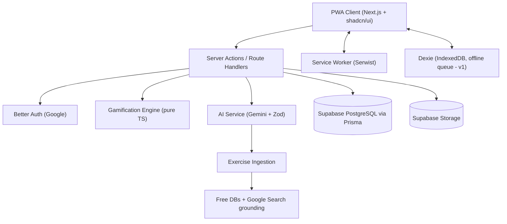
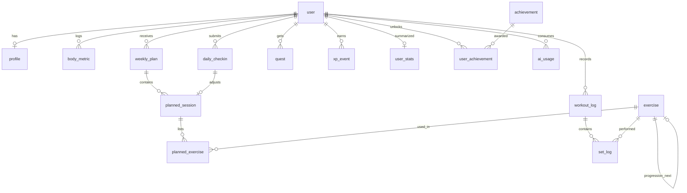
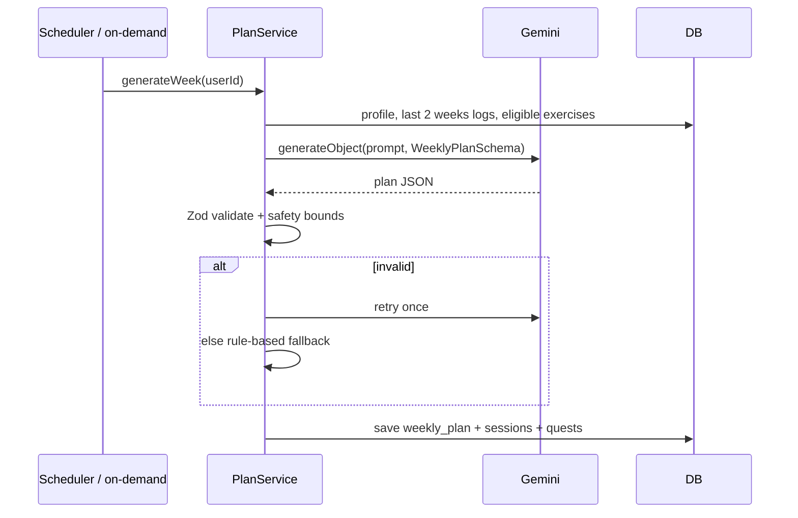

# Architecture — Calisthenics Quest

## 1. Overview



Principles: AI plans, code counts · validate all AI output · offline‑first logging (v1) · secrets server‑only · authorization in the server layer.

## 2. Directory Layout

```
src/
├── app/
│   ├── (auth)/sign-in/
│   ├── (app)/today/ plan/ log/ body/ profile/
│   ├── onboarding/
│   └── api/auth/[...all]/route.ts
├── components/{ui,reui,features}/
├── i18n/                 # next-intl request config
├── lib/
│   ├── auth/             # Better Auth server + client
│   ├── db/               # Prisma client singleton
│   ├── ai/               # prompts, Zod schemas, safety bounds
│   ├── gamification/     # xp, level, streak, quests (pure functions)
│   └── offline/          # Dexie schema, sync queue (v1)
├── server/
│   ├── actions/          # server actions (thin, auth-checked)
│   └── services/         # business logic
messages/en.json          # id.json later
prisma/schema.prisma
```

## 3. Data Model (draft)



Better Auth owns `user`, `session`, `account`, `verification`.

| Table | Key fields |
|---|---|
| `profile` | experienceLevel (`none/beginner/intermediate/advanced`), goals[], equipment[], trainingDays[], sessionMinutes, injuries[], heightCm, disclaimerAcceptedAt, locale, timezone |
| `body_metric` | type (`weight/height/waist/...`), value, unit, measuredAt |
| `exercise` | slug, name, pattern (push/pull/legs/core/skill), difficulty (1–10), equipment[], measure (`reps/seconds`), cues, contraindications[], progressionNextId, **status (`verified/unverified`)**, source (`seed/ai`), sourceUrl, license |
| `weekly_plan` | weekStart, status, aiModel, rawJson, fallbackUsed |
| `planned_session` | date, focus, isRest, adjustedFromId? |
| `planned_exercise` | exerciseId, sets, targetReps / targetSeconds, restSeconds, order |
| `daily_checkin` | date, energy (1–5), soreness (1–5), painAreas[], minutesAvailable |
| `workout_log` / `set_log` | clientId (UUID, idempotent sync), startedAt, completedAt / reps, seconds, rpe |
| `quest` | type (`daily/weekly/side`), key, target, progress, status, periodStart, xpReward |
| `xp_event` | source (`quest/session/streak/badge`), amount, refId, createdAt |
| `user_stats` | totalXp, level, currentStreak, longestStreak, freezesAvailable, lastActiveDate |
| `achievement` / `user_achievement` | key, criteria / unlockedAt |
| `ai_usage` | kind (`weekly/daily/discovery`), date, tokens, success |

## 4. AI Flows

### 4.1 Weekly plan



Trigger: on onboarding completion and on first app open of a new week (lazy), not a cron, to keep infra simple.

### 4.2 Daily adjustment

Input: planned session + check‑in. Output: `AdjustedSessionSchema`. Rules enforced in code after AI:
- Volume within **−40% / +15%** of planned.
- Only exercises from the eligible set (same pattern, ±1 difficulty).
- Pain areas → remove contraindicated exercises.
- Limit: 1 per user per day (`ai_usage`). Timeout 15 s → planned session.

### 4.3 Eligible exercise set

`status=verified OR (status=unverified AND level != beginner)` ∩ user equipment ∩ not contraindicated. Passed to the AI as an ID list — the AI may only return these IDs.

### 4.4 Safety bounds (weekly)

- ≤ 1 progression step per movement per week.
- ≤ 10% total volume increase week over week.
- Difficulty within the user's level band.

### 4.5 Schema sketch

```ts
const PlannedExercise = z.object({
  exerciseId: z.string(),
  sets: z.number().int().min(1).max(8),
  targetReps: z.number().int().min(1).max(50).optional(),
  targetSeconds: z.number().int().min(5).max(300).optional(),
  restSeconds: z.number().int().min(15).max(300),
});
const WeeklyPlanSchema = z.object({
  sessions: z.array(z.object({
    dayOfWeek: z.number().int().min(0).max(6),
    focus: z.string(),
    exercises: z.array(PlannedExercise).min(1).max(10),
  })),
  notes: z.string().max(500),
});
```

## 5. Exercise Ingestion

1. **Seed script** (`prisma/seed.ts`): import from free-exercise-db (public domain) and wger (CC‑BY‑SA, store attribution), filter bodyweight/calisthenics equipment, map to our fields, mark `verified`, and hand‑curate progression chains.
2. **AI discovery** (when the eligible set lacks coverage for a pattern/level): Gemini with Google Search grounding → `ExerciseCandidateSchema` → dedupe by slug and name similarity → reject if equipment/difficulty out of range → save as `unverified` with `sourceUrl`.
3. UI shows a warning badge for `unverified`; the owner can promote to `verified` later.

## 6. Gamification Engine

Pure, unit‑tested functions in `src/lib/gamification`. All values come from logs, so stats can be rebuilt.

- **XP (draft):** session completed = 100 × completion ratio; side quest = 25; weekly quest = 200; streak bonus = +5 per streak day (cap 50). Based on completion/effort, not raw volume, so it's fair across levels.
- **Level curve:** `xpForLevel(n) = 100 × n^1.5` (cumulative).
- **Streak:** counts scheduled training days completed. Rest days are neutral. A missed training day consumes a freeze if available (1 per ISO week), otherwise resets.
- **Quests:** daily quest derived from today's planned session + 1–2 side quests from a rule pool (log weight, mobility, plank). Weekly quests in v1.

## 7. i18n

`next-intl` with locale‑agnostic routes (cookie/profile locale). `messages/en.json` now; `id.json` later. AI responses use the user's locale.

## 8. Offline Strategy (v1)

- Serwist precaches the app shell and caches GET data (stale‑while‑revalidate).
- Workout logs are written to Dexie first with a client UUID, then synced via a server action. The server upserts by `clientId` (idempotent).
- Gamification is recalculated server‑side after sync.

## 9. Security

- Gemini, Supabase service role, and OAuth secrets are server‑only.
- Every server action calls `requireSession()` and scopes queries by `userId`.
- Supabase is accessed only via Prisma from the server, with no client‑side DB access, so RLS doesn't depend on `auth.uid()`.
- Storage uses a private bucket with signed URLs.
- AI rate limits per user via `ai_usage`.

## 10. Environment Variables

| Var | Purpose |
|---|---|
| `DATABASE_URL` | Supabase pooled connection (pgbouncer) |
| `DIRECT_URL` | Direct connection for migrations |
| `BETTER_AUTH_SECRET`, `BETTER_AUTH_URL` | Better Auth |
| `BETTER_AUTH_GOOGLE_CLIENT_ID`, `BETTER_AUTH_GOOGLE_CLIENT_SECRET` | Google OAuth (redirect: `{BETTER_AUTH_URL}/api/auth/callback/google`) |
| `NEXT_PUBLIC_SUPABASE_URL`, `SUPABASE_SERVICE_ROLE_KEY` | Storage |
| `GOOGLE_GENERATIVE_AI_API_KEY` | Gemini |
| `ALLOWED_EMAILS` | Optional comma-separated sign-in allowlist (family scale) |
| `VAPID_PUBLIC_KEY`, `VAPID_PRIVATE_KEY` | Web Push (v1.5) |

**Runtime notes:** Prisma 7 uses the `@prisma/adapter-pg` driver adapter with `DATABASE_URL` (pooler); `prisma.config.ts` uses `DIRECT_URL` for migrations. Route protection: `src/proxy.ts` (Next 16 replacement for middleware) does an optimistic cookie check; real checks run server-side via `requireSession()` / `requireOnboarded()` inside `<Suspense>` (Cache Components enabled).
