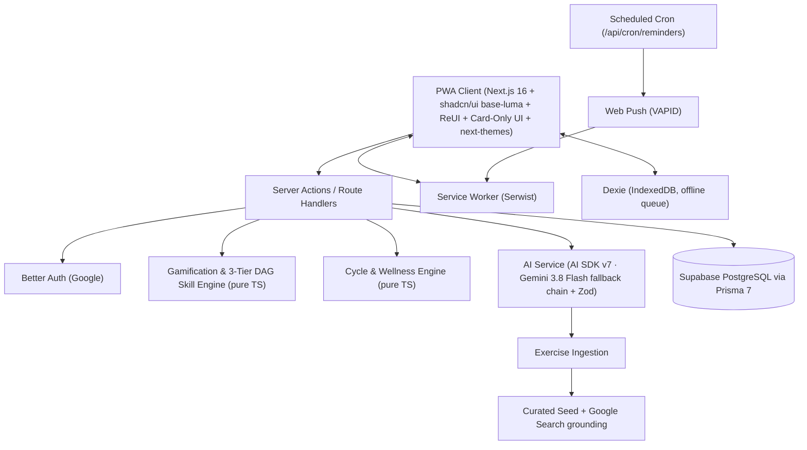
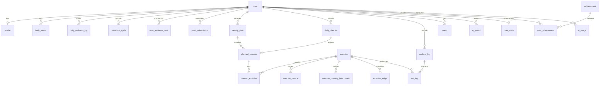
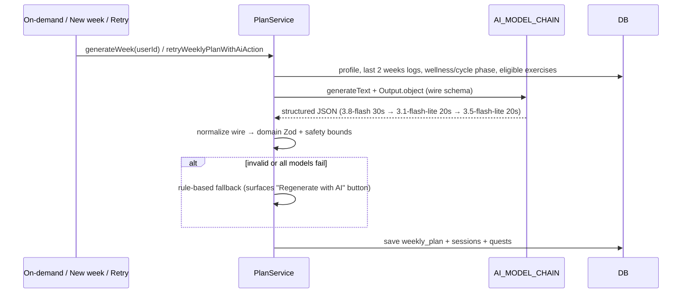

# Architecture — Calisthenics Quest

## 1. Overview



Principles: AI plans, code counts · validate all AI output · offline‑first logging · secrets server‑only · authorization in the server layer.

## 2. Directory Layout

```
src/
├── app/
│   ├── (auth)/sign-in/
│   ├── (app)/
│   │   ├── today/        # Unified Train hub: Today + Logger + Weekly Plan + 26-region Muscle Map
│   │   ├── calendar/     # Borderless Streak & Daily Wellness Tracker (v2)
│   │   ├── exercises/    # Exercise Library: List + 3-Tier DAG Skill Tree (v2)
│   │   ├── profile/      # 4-Tab Profile Hub: Overview + Metrics + Body + Settings (Theme, Cycle, Push, Delete Account)
│   │   ├── plan/         # Legacy redirect → /today?tab=plan
│   │   ├── log/          # Legacy redirect → /today?tab=log
│   │   └── body/         # Legacy redirect → /profile?tab=body
│   ├── onboarding/       # Multi-step onboarding & profile-hydrated Redo Onboarding
│   ├── manifest.ts       # PWA Web App Manifest
│   └── api/
│       ├── auth/[...all]/route.ts
│       └── cron/reminders/route.ts   # Scheduled training & H-2 period Web Push trigger
├── components/
│   ├── ui/               # shadcn/ui (base-luma, @base-ui/react)
│   ├── reui/             # ReUI primitives (DatePicker, TimePicker, NumberField, Badge, Alert, etc.)
│   ├── theme-provider.tsx # next-themes provider + dynamic meta theme-color sync
│   └── features/         # auth, body, calendar, exercises, gamification, logger, metrics, muscles, onboarding, plan, profile, push, pwa, shell
├── i18n/                 # next-intl request config
├── lib/
│   ├── auth/             # Better Auth server + client + email allowlist
│   ├── db/               # Prisma 7 client singleton (@prisma/adapter-pg)
│   ├── ai/               # model fallback chain (model-config.ts), wire & domain Zod schemas, safety bounds
│   ├── body/             # BMI, weight trend points, batch measurement schemas & history grouping
│   ├── exercises/        # eligibility, 26-region muscles, heatmap aggregator, DAG validator
│   ├── gamification/     # xp, level, streak, quests, achievements, 3-tier skill tree & layout (pure TS)
│   ├── metrics/          # deterministic consistency, adherence, delta, bucket & heatmap aggregator (pure TS)
│   ├── wellness/         # luteal-anchored cycle engine, sleep duration, wellness schemas (pure TS)
│   ├── validation/       # onboarding & delete-account Zod schemas
│   ├── push/             # Web Push VAPID sender & reminder eligibility logic
│   └── offline/          # Dexie schema, queue merge logic, optimistic offline logger hook
├── server/
│   ├── actions/          # thin auth-checked server actions (account, body, onboarding, plan, push, wellness, workout)
│   └── services/         # business logic services
├── sw.ts                 # Serwist Service Worker source (precaching + Web Push handlers)
messages/en.json          # id.json later
prisma/
├── schema.prisma
├── seed.ts
└── seed-data/            # modular 116-exercise catalog (foundations, push, pull, legs, core, skill-mobility, edges)
```

## 3. Data Model



Better Auth owns `user`, `session`, `account`, `verification`. All 16 user-owned tables define `onDelete: Cascade` to `user`.

| Table | Key fields |
|---|---|
| `profile` | experienceLevel (`NONE/BEGINNER/INTERMEDIATE/ADVANCED`), maxPushups?, maxPullups?, plankSeconds?, goals[], equipment[], trainingDays[], sessionMinutes, injuries[], injuryNotes?, birthYear?, sex?, tracksPeriod, lastPeriodStartDate?, averageCycleDays (28), averagePeriodDays (5), cycleRegularity (`REGULAR/IRREGULAR/UNKNOWN`), lutealPhaseDays (14), periodReminderEnabled, lastPeriodReminderDate?, reminderEnabled, reminderTime, lastReminderDate?, disclaimerAcceptedAt, onboardingCompletedAt, locale, timezone |
| `body_metric` | type (`WEIGHT/HEIGHT/WAIST/CHEST/ARM`), value (`Decimal(6,2)`), unit, measuredAt |
| `daily_wellness_log` | userId + date (unique), periodFlow? (`light/medium/heavy/super_heavy`), painTags[], painSeverity?, painDetails?, crampSeverity?, medications[], supplements[], sleepTime?, wakeTime?, sleepDurationMinutes?, sleepQuality?, energyLevel?, stressLevel?, moodTags[], hydrationMl?, notes? |
| `menstrual_cycle` | userId + startDate (unique), endDate?, cycleLengthDays?, periodLengthDays?, isConfirmed, notes? |
| `user_wellness_item` | userId + kind (`SUPPLEMENT/MEDICATION`) + slug (unique), name, isActive |
| `push_subscription` | userId, endpoint (unique), p256dh, auth, createdAt |
| `exercise` | slug (unique), name, pattern (`PUSH/PULL/LEGS/CORE/SKILL/MOBILITY`), difficulty (1–10), equipment[], measure (`REPS/SECONDS`), primaryMuscles[], secondaryMuscles[], masteryTargetSets, masteryTargetReps?, masteryTargetSeconds?, branchKey?, treeTier, progressionNextId?, cues[], contraindications[], status (`VERIFIED/UNVERIFIED`), source (`SEED/AI`), sourceUrl?, license? |
| `exercise_muscle` | exerciseId + muscleGroup (unique, 26 anatomical regions), role (`PRIMARY/SECONDARY/STABILIZER`), activationWeight |
| `exercise_mastery_benchmark` | exerciseId + tier (`BRONZE/SILVER/GOLD`, unique), targetSets, targetReps?, targetSeconds?, minConsecutiveSessions, maxRpe?, tempo?, formStandard?, unlocksNext |
| `exercise_edge` | fromExerciseId + toExerciseId (unique), kind (`PROGRESSION/PREREQUISITE/ALTERNATIVE`), branchLabel?, requiredTier, order |
| `weekly_plan` | weekStart, status, aiModel, rawJson, fallbackUsed |
| `planned_session` | date, focus, isRest, adjustedFromId? |
| `planned_exercise` | exerciseId, sets, targetReps / targetSeconds, restSeconds, order |
| `daily_checkin` | date, energy (1–5), soreness (1–5), painAreas[], minutesAvailable |
| `workout_log` / `set_log` | clientId (UUID, idempotent sync), startedAt, completedAt / reps, seconds, rpe |
| `quest` | type (`DAILY/WEEKLY/SIDE`), key, target, progress, status, date, xpReward |
| `xp_event` | source (`QUEST/SESSION/STREAK/BADGE`), amount, refId, createdAt |
| `user_stats` | totalXp, level, currentStreak, longestStreak, freezesAvailable, freezeWeekKey?, lastActiveDate? |
| `achievement` / `user_achievement` | key, criteria / unlockedAt |
| `ai_usage` | kind (`WEEKLY/DAILY/DISCOVERY`), date, tokens, success |

## 4. AI Flows

### 4.1 Weekly plan & Model Fallback Chain



- **Client & Model Chain (`src/lib/ai/model-config.ts`, `src/server/services/ai-client.ts`):** Uses AI SDK v7 (`generateText` + `Output.object({ schema })`) across `AI_MODEL_CHAIN` (`gemini-3.8-flash` `30s` → `gemini-3.1-flash-lite` `20s` → `gemini-3.5-flash-lite` `20s`, `maxRetries: 0` per model) with lightweight Gemini wire schemas normalized into domain Zod schemas (`src/lib/ai/plan-schema.ts`, `src/lib/ai/exercise-schema.ts`).
- **Triggers & Retry:** Triggered on-demand from `/today` and lazily on the first app open of a new week. When `fallbackUsed` is `true`, `/today` → Weekly Plan surfaces a **"Regenerate with AI"** button (`retryWeeklyPlanWithAiAction`). When `profile.tracksPeriod` is enabled, `PlanService` computes luteal-anchored cycle phases (`menstrual`, `follicular`, `ovulatory`, `luteal`) for each day of the week plus recent 14-day wellness trends so AI adapts intensity/volume within strict safety bounds.

### 4.2 Daily adjustment

Input: planned session + check‑in + today's `daily_wellness_log` (period flow, pain tags & severity, medications, sleep duration/quality, readiness) + current cycle phase (if enabled). Output: `AdjustedSessionSchema`. Rules enforced in code after AI:
- Volume within **−40% / +15%** of planned.
- Only exercises from the eligible set (same pattern, ±1 difficulty).
- Pain areas (from check‑in and wellness log) → remove contraindicated exercises.
- Limit: 1 per user per day (`ai_usage`). Per-model fallback chain (`30s → 20s → 20s`) before falling back to the planned session on total timeout/error.

### 4.3 Eligible exercise set

`status=VERIFIED OR (status=UNVERIFIED AND level != BEGINNER)` ∩ user equipment ∩ not contraindicated. Passed to the AI as an ID list — the AI may only return these IDs.

### 4.4 Safety bounds (weekly)

- ≤ 1 progression step per movement per week.
- ≤ 10% total volume increase week over week.
- Difficulty within the user's level band.

### 4.5 Schema sketch

```ts
const PlannedExercise = z.object({
  exerciseId: z.string(),
  sets: z.number().int().min(1).max(8),
  targetReps: z.number().int().min(1).max(50).optional(),
  targetSeconds: z.number().int().min(5).max(300).optional(),
  restSeconds: z.number().int().min(15).max(300),
});
const WeeklyPlanSchema = z.object({
  sessions: z.array(z.object({
    dayOfWeek: z.number().int().min(0).max(6),
    focus: z.string(),
    exercises: z.array(PlannedExercise).min(1).max(10),
  })),
  notes: z.string().max(500),
});
```

## 5. Exercise Ingestion & 26-Region Anatomical Muscle Map

1. **Seed script** (`prisma/seed.ts` + `prisma/seed-data/{foundations,push,pull,legs,core,skill-mobility,edges}.ts`): seeds **116 curated calisthenics exercises** (`98` core progressions + `18` zero-equipment `Never trained` foundations), **506 relational muscle mappings** (`ExerciseMuscle`) across **26 anatomical regions**, **348 3-tier mastery benchmarks** (`BRONZE`/`SILVER`/`GOLD`), and **121 DAG progression edges** (`ExerciseEdge`), validated for acyclicity before writing.
2. **AI discovery** (when the eligible set lacks coverage for a pattern/level): `generateGroundedSearchWithFallback` (`google.tools.googleSearch({})`) across `AI_MODEL_CHAIN`, followed by structured normalization to `ExerciseCandidateSchema` (including `primaryMuscles[]` & `secondaryMuscles[]`) → dedupe by slug and name similarity → reject if equipment/difficulty out of range → save as `UNVERIFIED` with `sourceUrl`.
3. **Anatomical Body Map** (`src/components/features/muscles/`): zero-dependency front/back Male & Female SVG models ported under MIT license from `HichamELBSI/react-native-body-highlighter`, subdivided to cover all 26 `MuscleGroup` regions using native sub-paths and namespaced SVG `<clipPath>` splits. Automatically resolves gender from `profile.sex`, renders theme-aware OKLCH fills (`Primary`, `Secondary`, `Untargeted`), hover outlines, and pointer-following tooltips.

## 6. Gamification, Skill Tree, Consistency Metrics & Cycle Engines

Pure, unit‑tested TypeScript modules in `src/lib/gamification`, `src/lib/exercises`, `src/lib/metrics`, and `src/lib/wellness`:

- **XP:** session completed = `100 × completion ratio`; side quest = `25`; weekly quest = `200`; streak bonus = `+5` per streak day (cap `50`).
- **Level curve:** `xpForLevel(n) = 100 × n^1.5` (cumulative).
- **Streak:** counts scheduled training days completed. Rest days are neutral. A missed training day consumes a freeze if available (1 per ISO week), otherwise resets.
- **Quests & Achievements:** daily quest derived from today's planned session + side quests + weekly quests + deterministic achievement catalog.
- **3-Tier DAG Skill Tree (`skill-tree.ts`, `skill-tree-layout.ts`):** evaluates `BRONZE`, `SILVER`, and `GOLD` mastery per exercise from `SetLog` history, unlocks downstream nodes via multi-parent `ExerciseEdge` prerequisites (`Locked`, `On going`, `Mastered`), and uses global-tier compaction so `Never trained` foundation exercises anchor the lowest tier cleanly.
- **Consistency & Adherence Engine (`src/lib/metrics/consistency.ts`, `src/server/services/metrics-service.ts`):** computes `7D` / `30D` / `90D` / `All` adherence metrics from `WorkoutLog` and `Profile` with exact streak/freeze parity (`evaluateStreakHistory()`), new-account window clamping, pending-today non-penalty rules, period-over-period deltas (`7D`/`30D`/`90D`), adaptive `day` / `week` / `month` (`>16w`) bucketing, tap-inspectable heatmap cells (`≤ 12` weeks), and Mon–Sun weekday breakdown.
- **Cycle & Wellness Engine (`cycle-engine.ts`, `cycle-and-wellness.ts`):** reconciles discrete daily period logs into `MenstrualCycle` episodes, computes luteal-anchored cycle phases (`menstrual`, `follicular`, `ovulatory`, `luteal` — no fertile window), protects configured `averagePeriodDays` / `averageCycleDays` against ongoing partial episodes, and predicts upcoming period windows.

## 7. i18n, Theming & UI Surface System

- **i18n:** `next-intl` with locale‑agnostic routes (cookie/profile locale). `messages/en.json` now; `id.json` planned. AI responses use the user's locale.
- **Theming:** `next-themes` (`attribute="class"`, `defaultTheme="system"`, `enableSystem`) wrapped in `src/components/theme-provider.tsx` with dynamic `<meta name="theme-color">` synchronization (`#fafafa` light / `#121212` dark), `base-luma` OKLCH tokens, and high-contrast multi-series chart tokens (`--chart-1..5`) in `src/app/globals.css`.
- **UI Surface System:** Unified **Card-Only UI (Style 4)** using `<Card size="sm">` outer containers (`rounded-4xl bg-card shadow-md ring-1`), borderless tonal sub-tiles (`rounded-2xl bg-muted/50`), iOS-style grouped settings rows (`ProfileSettingsTab`), 24-hour ReUI `TimePicker` (`wellness-category-cards.tsx`, `push-reminders-card.tsx`), and shared `MetricHistoryCollapsible` (`@/components/ui/collapsible`) for Weight & Batch Body Measurements (`src/lib/body/metrics.ts`).

## 8. Offline Strategy & Push Reminders

- **Offline:** Serwist (`serwist.config.mjs`, Next.js 16 Turbopack) precaches the app shell in production; `pwa-provider.tsx` automatically unregisters lingering Service Workers and clears caches in `development` mode to prevent stale Turbopack chunks. Workout logs write to Dexie (`calisthenics_quest_offline_v1`) first with a client UUID, bridge synced sets via `recentlySynced` until RSC revalidation arrives, and sync idempotently via `syncOfflineWorkoutBatchAction`.
- **Push Reminders:** Client subscribes via PushManager using `VAPID_PUBLIC_KEY` and stores subscriptions in `push_subscription`. `src/sw.ts` handles `push` and `notificationclick`. `/api/cron/reminders` (authenticated via `CRON_SECRET`) dispatches both scheduled training reminders (`trainingDays` + `reminderTime`) and H-2 upcoming period reminders (`periodReminderEnabled`, deduplicated via `lastPeriodReminderDate`).

## 9. Security & Account Lifecycle

- Gemini, VAPID private key, `CRON_SECRET`, and OAuth secrets are server‑only.
- Every server action calls `requireSession()` / `requireOnboarded()` and scopes queries by `userId`.
- Supabase PostgreSQL is accessed exclusively via Prisma from the server (no client‑side DB access).
- AI rate limits per user via `ai_usage`.
- **Permanent Delete Account (`account-service.ts`, `actions/account.ts`):** requires explicit `"DELETE"` confirmation, unsubscribes browser Web Push, deletes Better Auth `verification` tokens by email and the `user` row inside `db.$transaction` (cascading all 16 user-owned tables), clears Dexie offline tables (`clearAllOfflineData()`), clears auth cookies, and redirects to `/sign-in`.

## 10. Environment Variables

| Var | Purpose |
|---|---|
| `DATABASE_URL` | Supabase pooled connection (pgbouncer) |
| `DIRECT_URL` | Direct connection for migrations |
| `BETTER_AUTH_SECRET`, `BETTER_AUTH_URL` | Better Auth |
| `BETTER_AUTH_GOOGLE_CLIENT_ID`, `BETTER_AUTH_GOOGLE_CLIENT_SECRET` | Google OAuth (redirect: `{BETTER_AUTH_URL}/api/auth/callback/google`) |
| `GOOGLE_GENERATIVE_AI_API_KEY` | Gemini |
| `ALLOWED_EMAILS` | Optional comma-separated sign-in allowlist (family scale) |
| `VAPID_PUBLIC_KEY`, `VAPID_PRIVATE_KEY` | Web Push reminders |
| `CRON_SECRET` | Bearer secret authenticating `/api/cron/reminders` |

**Runtime notes:** Prisma 7 uses the `@prisma/adapter-pg` driver adapter with `DATABASE_URL` (pooler); `prisma.config.ts` uses `DIRECT_URL` for migrations. Route protection: `src/proxy.ts` (Next 16 replacement for middleware) does an optimistic cookie check; real checks run server-side via `requireSession()` / `requireOnboarded()` inside `<Suspense>` (Cache Components enabled).
